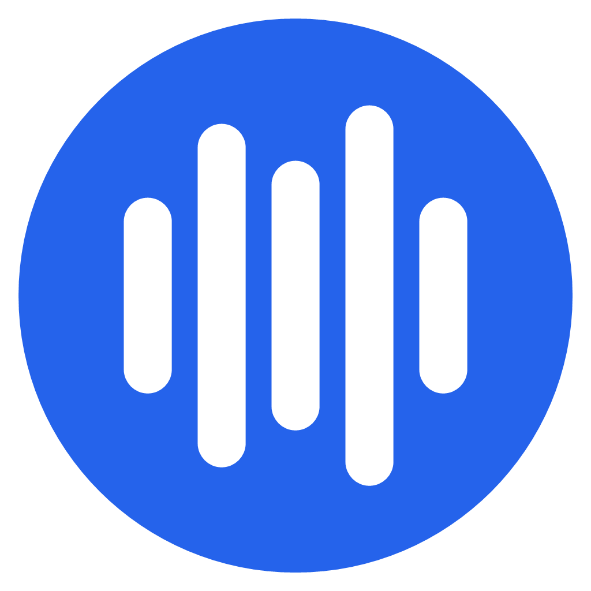
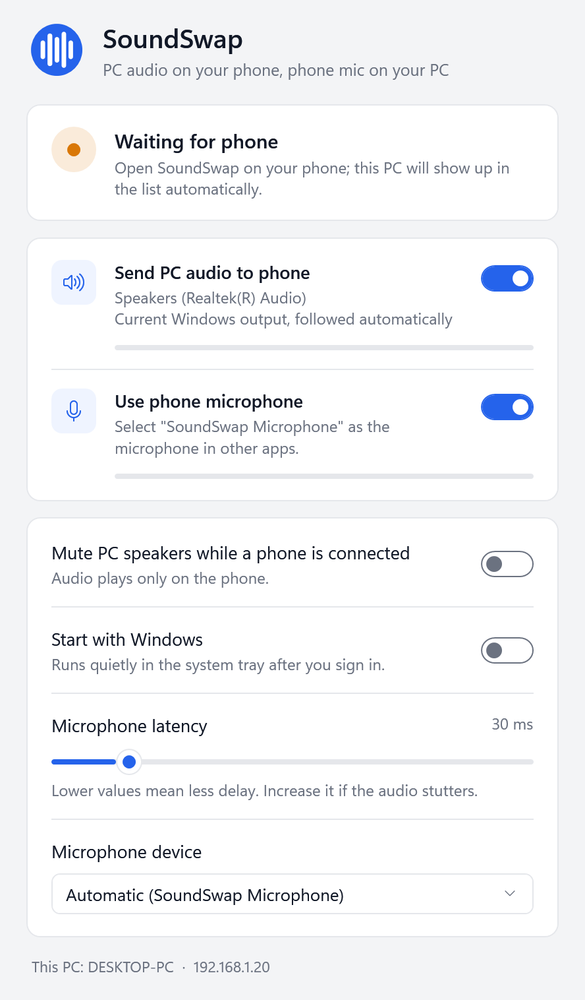
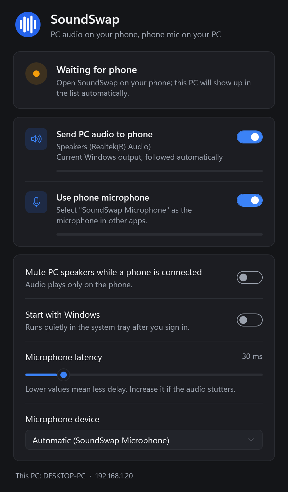
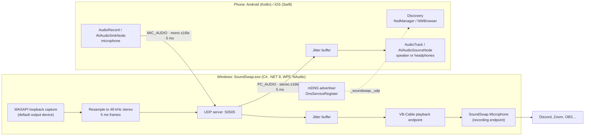

<p align="center">
  
</p>

<h1 align="center">SoundSwap</h1>

<p align="center">
  Low-latency, two-way audio between a Windows PC and a phone over Wi-Fi or USB:<br>
  hear your PC on your phone, and use your phone as your PC's microphone.
</p>

<p align="center">
  <a href="../../actions/workflows/windows.yml"></a>
  <a href="../../actions/workflows/android.yml"></a>
  <a href="../../actions/workflows/ios.yml"></a>
  <a href="LICENSE"></a>
</p>

<p align="center"><b>English</b> · <a href="README.tr.md">Türkçe</a></p>

<p align="center">
  
  &nbsp;
  
</p>

## Features

- **PC → phone:** everything playing on Windows (games, music, calls) comes out of the phone's speaker or the headphones plugged into it.
- **Phone → PC:** the phone's microphone (or its headset mic) shows up in Windows as a normal input device, **SoundSwap Microphone**, usable in Discord, Zoom, OBS and so on.
- **Low latency:** uncompressed 48 kHz PCM in 5 ms UDP packets, an adaptive jitter buffer with clock-drift compensation, and low-latency audio paths on every platform.
- **Several phones at once:** up to 8 phones can listen at the same time, and their microphones are mixed into one *SoundSwap Microphone*, each with its own jitter buffer.
- **USB connection:** over a USB cable (Android *USB tethering*, iPhone *Personal Hotspot*) for the lowest and steadiest latency; the apps detect it and list the PC with a USB label.
- **Zero configuration:** the PC advertises itself over mDNS/DNS-SD, so the phone apps list it automatically. No IP address to type (a manual fallback exists).
- **Follows the default device:** when you switch speakers in Windows, the capture moves to the new device by itself.
- **One-click virtual microphone:** downloads and installs VB-Audio Virtual Cable, checks its Authenticode signature first, and renames the device to *SoundSwap Microphone*.
- **Native apps on three platforms:** Windows (C#/WPF), Android (Kotlin/Jetpack Compose) and iOS (Swift/SwiftUI), with no third-party networking or audio libraries on mobile.
- Light and dark themes, system tray, start with Windows, keeps streaming with the phone screen off (Android foreground service / iOS background audio).

## Architecture



| Folder | Contents |
|---|---|
| [`windows/SoundSwap`](windows/SoundSwap) | Windows app: C#, .NET 8, WPF, NAudio |
| [`windows/SoundSwap.Tests`](windows/SoundSwap.Tests) | xUnit tests for the jitter buffer, the microphone mixer, USB link detection and the protocol |
| [`android`](android) | Android app: Kotlin, Jetpack Compose, Android 8.0+ (with JVM unit tests) |
| [`ios`](ios) | iOS app: Swift, SwiftUI, iOS 15+, project generated with XcodeGen |
| [`.github/workflows`](.github/workflows) | CI for all three platforms and the release pipeline |
| [`build.ps1`](build.ps1) | Builds the Windows app and the Android APK into `dist/` |

## How it works

### Wire protocol

Everything is little-endian. The PC listens on **UDP 50505**. Audio is **PCM s16le at 48 000 Hz**, sent in 5 ms packets. Every packet starts with an 8-byte header:

| Bytes | Field |
|---|---|
| 0–1 | magic `'S' 'W'` |
| 2 | protocol version (`1`) |
| 3 | packet type |
| 4–7 | sequence number (`uint32`) |

| Type | Direction | Payload |
|---|---|---|
| 1 `HELLO` | phone → PC, every 500 ms | `[flags][device name, UTF-8]`; flag 1 = wants PC audio, 2 = sends mic |
| 2 `HELLO_ACK` | PC → phone | PC name (UTF-8) |
| 3 `PC_AUDIO` | PC → phone | stereo, 240 frames (5 ms) = 960 bytes |
| 4 `MIC_AUDIO` | phone → PC | mono, 240 samples (5 ms) = 480 bytes (the PC accepts any length) |
| 5 `BYE` | phone → PC | – |
| 6 `DISCOVER` | phone → broadcast | – |
| 7 `DISCOVER_REPLY` | PC → phone | PC name (UTF-8) |

- `HELLO` doubles as a keep-alive: every phone that sends one is a client (up to 8) and is dropped after 3 s of silence or on `BYE`.
- Receivers use the sequence number to discard late and duplicate packets and to count losses.
- Audio is deliberately **not compressed**: a codec would add algorithmic delay and CPU cost. The price is about 1.6 Mbit/s PC → phone and 0.8 Mbit/s back, which is trivial on a LAN.
- Outgoing packets are marked DSCP EF (`IP_TOS 0xB8`) so Wi-Fi access points that honour WMM can put them in the voice queue.

### Jitter buffer with drift compensation

Wi-Fi delivers packets in bursts, and the sender's and receiver's sound cards run on slightly different clocks. The same ring-buffer algorithm is implemented on all three platforms ([C#](windows/SoundSwap/JitterBuffer.cs), [Kotlin](android/app/src/main/java/com/soundswap/app/JitterBuffer.kt), [Swift](ios/SoundSwap/JitterBuffer.swift)):

1. **Priming:** output silence until the buffer reaches the target level (user-adjustable, e.g. 20–40 ms on Wi-Fi).
2. **Underrun:** if the buffer runs dry, play what is left, pad with silence and go back to priming, so a late burst does not cause repeated clicks.
3. **Drift compensation:** track the *minimum* fill level over every 0.5 s window. If even the minimum stayed more than 8 ms above the target, the sender's clock is running fast and latency is creeping up, so the excess is dropped in one step (down to target + 4 ms). Using the minimum rather than the average means normal jitter never triggers a drop.
4. **Overflow:** if a write does not fit, the oldest samples are discarded, so the buffer always holds the newest audio.

These rules are covered by unit tests on Windows and Android.

### Several phones at once

[`AudioServer`](windows/SoundSwap/AudioServer.cs) keeps a table of clients keyed by their UDP endpoint. Each 5 ms frame of PC audio is encoded once and sent to every phone that asked for it, so all phones see the same continuous sequence. Microphones go through [`MicMixer`](windows/SoundSwap/MicMixer.cs): every phone gets its own jitter buffer, and the output callback sums them and clips to full scale. A phone whose buffer is still priming contributes silence instead of holding the others back. The channel list is copy-on-write, so the real-time audio thread never takes a lock.

### USB connection

Android's *USB tethering* and the iPhone's *Personal Hotspot* over USB both create a network over the cable, so SoundSwap runs over USB with no extra protocol: the same UDP packets, just without Wi-Fi's jitter.

- **Windows:** [`LinkInfo`](windows/SoundSwap/LinkInfo.cs) recognises the tethering adapters (Remote NDIS, Apple Mobile Device Ethernet, NCM) and marks phones on their subnet as connected via USB.
- **Android:** [`UsbLink`](android/app/src/main/java/com/soundswap/app/UsbLink.kt) finds the `rndis`/`usb`/`ncm` interfaces. The PC address on that subnet is preferred over the Wi-Fi one and listed first with a USB label. A helper dialog opens the tethering settings.
- **iOS:** PCs on the Personal Hotspot subnet (`172.20.10.0/28`) are preferred and labelled. Windows needs Apple's USB driver (the Apple Devices app or iTunes).

### Capturing PC audio: WASAPI loopback

[`LoopbackSource`](windows/SoundSwap/LoopbackSource.cs) opens the **default render device** in shared-mode loopback with a 20 ms buffer and polls it every millisecond. NAudio's ready-made `WasapiLoopbackCapture` uses a 100 ms buffer with a 50 ms sleep, which was too slow. Whatever the device mix format is (float/PCM, any channel count, 44.1/48/96 kHz), it is converted to 48 kHz stereo and cut into 5 ms frames. Loopback produces no data while nothing is playing, so the app also plays silence into the device; the capture stream then never stalls and keeps arriving steadily on the device clock. An `IMMNotificationClient` watcher switches the capture when the user changes the default output.

### Zero-config discovery: mDNS / DNS-SD

- **Windows:** [`ServiceAdvertiser`](windows/SoundSwap/ServiceAdvertiser.cs) registers `<PC name>._soundswap._udp.local` (SRV port 50505, TXT `v=1`) with `DnsServiceRegister` from `dnsapi.dll` via P/Invoke. This uses the mDNS responder built into Windows 10 1903+, so no Bonjour installation is needed.
- **Android:** [`PcDiscovery`](android/app/src/main/java/com/soundswap/app/PcDiscovery.kt) browses with `NsdManager` and, in parallel, sends `DISCOVER` broadcasts, since some routers filter multicast.
- **iOS:** [`PcBrowser`](ios/SoundSwap/PcBrowser.swift) uses `NWBrowser` with `.bonjour(type: "_soundswap._udp")`. The service type is declared in `NSBonjourServices` for the local-network permission.

### Virtual microphone: VB-Cable, verified

Windows has no API for creating an audio input device without a kernel driver, so SoundSwap uses [VB-Audio Virtual Cable](https://vb-cable.com). The phone's audio is played into the cable's playback endpoint and other apps record from its capture endpoint. [`VirtualMic`](windows/SoundSwap/VirtualMic.cs) installs it in one click:

1. Downloads the official driver pack from vb-audio.com over HTTPS.
2. Starts an elevated copy of SoundSwap (`--vmic-install`) so the main app never runs as admin.
3. **Verifies the installer before running it:** `WinVerifyTrust` must accept the Authenticode signature, and the signing certificate must belong to VB-Audio's publisher. Otherwise installation stops.
4. Runs the setup silently, waits for the endpoints to appear and renames them to *SoundSwap Microphone* by writing `PKEY_Device_DeviceDesc`, the same property the Windows Sound settings "Rename" button writes. Renaming needs no admin rights.

The received microphone stream goes through its own jitter buffer and a WASAPI shared-mode output with a 20 ms latency.

### Mobile audio paths

- **Android:** `AudioTrack` with `PERFORMANCE_MODE_LOW_LATENCY` and `AudioRecord` on `THREAD_PRIORITY_URGENT_AUDIO` threads, an optional `AcousticEchoCanceler`, selectable input (built-in, wired, USB or Bluetooth SCO headset) and a foreground service so streaming continues with the screen off.
- **iOS:** `AVAudioEngine` with an `AVAudioSourceNode` that pulls straight from the jitter buffer, an `AVAudioSinkNode` for the microphone, a 5 ms preferred I/O buffer, and the `.voiceChat` mode when echo cancellation is on.

## Measured results

| Measurement | Result |
|---|---|
| Windows: loopback capture → UDP packet sent | ~30 ms |
| End-to-end PC → Android emulator, Wi-Fi LAN | ≈ 80 ms, 0 packet loss |
| Bandwidth | ~1.6 Mbit/s PC → phone, ~0.8 Mbit/s phone → PC |

Most of the end-to-end delay comes from the phone's own audio output path. A wired headset and 5 GHz Wi-Fi or USB tethering give the best results. Bluetooth headphones add 100–250 ms on their own.

## Installation

Prebuilt binaries are attached to each [GitHub Release](../../releases/latest).

### Windows 10 (1903+) / 11

1. Install the [.NET 8 Desktop Runtime](https://dotnet.microsoft.com/download/dotnet/8.0) if you do not have it, then run `SoundSwap.exe`.
2. When Windows Firewall asks, allow SoundSwap on **private networks**. If it does not ask, run this in an elevated terminal:
   ```bash
   netsh advfirewall firewall add rule name="SoundSwap" dir=in action=allow protocol=UDP localport=50505
   ```
3. To use the phone as a microphone, click **Install virtual microphone** and accept the UAC and driver prompts. Then choose **SoundSwap Microphone** as the input device in Discord, Zoom and other apps.
   - If VB-Cable is already installed, a **Rename to "SoundSwap Microphone"** link appears instead.
   - Optional, for lower latency: `VBCABLE_ControlPanel.exe` → *Options* → set **Max Latency** to 2048 or 1024.
4. Closing the window keeps SoundSwap running in the tray. Right-click the tray icon → **Exit** to quit.
5. Use **Mute PC speakers while a phone is connected** instead of turning the Windows volume down: lowering the volume also lowers the captured audio.

### Android 8.0+

Install `SoundSwap.apk` (allow installs from unknown sources) or use `adb install -r SoundSwap.apk`. Open the app and tap your PC in the list. Streaming continues with the screen off; the notification has a **Stop** button.

**USB:** connect the phone with a cable and turn on *USB tethering* (the app's **Connect with USB** button opens the setting). The PC then appears with a USB label. While tethering is on, Windows may route its internet traffic through the phone's mobile data.

### iOS 15+

iOS apps can only be built on macOS, and installing outside the App Store requires signing with your own Apple ID:

- **With a Mac:** `brew install xcodegen && cd ios && xcodegen generate && open SoundSwap.xcodeproj`, select your team under *Signing & Capabilities* and run on your device.
- **Without a Mac:** download `SoundSwap-unsigned.ipa` from a release or from the **iOS** workflow run, then sign and install it with [Sideloadly](https://sideloadly.io/) or AltStore. With a free Apple ID the signature has to be renewed every 7 days.

On first launch, allow **Local Network** access (needed for discovery). Microphone permission is requested on the first connection.

**USB:** connect the iPhone with a cable and turn on *Settings > Personal Hotspot > Allow Others to Join*. Windows needs the Apple Devices app (or iTunes) for the USB network driver. Personal Hotspot requires a cellular plan that allows it.

## Building from source

| Platform | Requirements | Command |
|---|---|---|
| Windows | .NET 8 SDK | `dotnet build windows/SoundSwap.sln -c Release` |
| Windows tests | .NET 8 SDK | `dotnet test windows/SoundSwap.Tests` |
| Android | JDK 17+ (e.g. Android Studio's bundled JBR), Android SDK 36 | `cd android && ./gradlew assembleRelease` |
| Android tests | same | `cd android && ./gradlew testReleaseUnitTest` |
| iOS | macOS, Xcode, XcodeGen | `cd ios && xcodegen generate`, then build in Xcode |
| Everything (Windows host) | the above | `powershell -ExecutionPolicy Bypass -File build.ps1` → `dist/` |

`SoundSwap.exe --theme=light|dark --screenshot=<file.png>` renders the main window to a PNG with placeholder machine details; this is how the screenshots above were made.

The release APK is signed with the debug key so anyone can build and sideload it. Configure your own signing key before distributing it.

## Limitations

- Up to 8 phones at a time.
- Traffic is **unencrypted and unauthenticated**. SoundSwap is meant for a trusted LAN or USB tether; never expose UDP 50505 to the internet.
- Windows only on the PC side (WASAPI, `dnsapi` mDNS, VB-Cable).
- The virtual microphone depends on the third-party VB-Cable driver, and its licence keeps "(VB-Audio Virtual Cable)" visible in the device name.
- A Bluetooth headset microphone forces the HFP "phone call" profile, which lowers both playback and mic quality. This is a Bluetooth limitation.
- The iOS build is unsigned; it has to be signed with your own Apple ID to install.

## Credits

- **[VB-CABLE Virtual Audio Device](https://vb-cable.com)** by VB-Audio Software (Vincent Burel) provides the virtual microphone. VB-CABLE is **donationware**: it is free to use, and if you find it useful, please support its author at [vb-cable.com](https://vb-cable.com). SoundSwap only downloads the official installer from VB-Audio's servers; it does not redistribute the driver.
- [NAudio](https://github.com/naudio/NAudio) by Mark Heath (MIT) for WASAPI access on Windows.
- [XcodeGen](https://github.com/yonaskolb/XcodeGen) for generating the iOS project.

## License

SoundSwap is released under the [MIT License](LICENSE). VB-CABLE is not part of this repository and is covered by its own licence.
